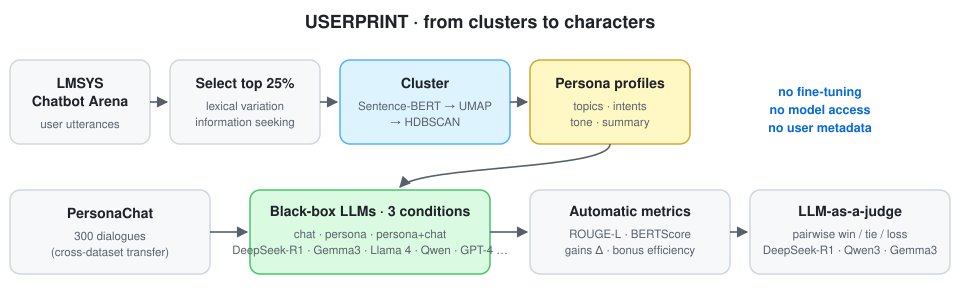

<div align="center">

# USERPRINT
### From Clusters to Characters: Cross-Dataset Transfer in LLM Personalization

[-1f6feb)](https://www.sciencedirect.com/science/article/pii/S1877050926000505)
[](https://www.sciencedirect.com/science/article/pii/S1877050926000505)
[](https://huggingface.co/datasets/abittolu/UserPrint)
[](#installation)
[](LICENSE)
[](https://github.com/marif561/Cross-Dataset_Transfer_LLM-_Personalization/actions/workflows/tests.yml)

Code and results for **"From Clusters to Characters: USERPRINT for Cross-Dataset Transfer in LLM Personalization"**, *Procedia Computer Science* 275 (2026) 410–419, 7th International Conference on AI in Computational Linguistics (ACLing 2025). Open access (CC BY-NC-ND 4.0).

Abiola T. O. · **Muhammad Arif** ✉ · Abiola O. J. · Oredeko O. B. · Tewodros A. B. · Ojo O. E. · C. E. Maldonado-Sifuentes · Calvo H.

*Instituto Politécnico Nacional (CIC-IPN), Mexico · Federal University Oye-Ekiti, Nigeria · University of Sunderland, UK · Colorado State University, USA*

</div>

---

## About the paper

Personalising large language models usually means fine-tuning, adding user metadata or hand-crafting prompt rules. These approaches are hard to scale, hard to interpret, and often impossible with closed models. **USERPRINT** moves personalisation into the **data layer**. It mines naturalistic user messages from the **LMSYS Chatbot Arena**, keeps the most diverse and information-seeking ones, and embeds them with Sentence-BERT. It then reduces them with UMAP and clusters them with HDBSCAN into **emergent personas**, each summarised as a short profile of topics, intents and tone. These persona profiles are then **transferred to a different dataset, PersonaChat**, and used as prompt conditions for black-box LLMs, with **no fine-tuning, model access or user metadata**. Across seven LLMs, measured with ROUGE-L, BERTScore and three LLM judges, **persona + chat** conditioning gives the most reliable alignment. Qwen3 leads chat-grounded settings, and GPT-4 and DeepSeek-R1 excel at persona-only alignment.

<p align="center">
  
</p>

## Highlights

- 🧩 **Zero-shot persona extraction.** Unsupervised clusters of real user behaviour become reusable "user fingerprints".
- 🔁 **Cross-dataset transfer.** Personas learned from LMSYS condition responses on PersonaChat.
- 🧪 **Three conditions.** *chat-only*, *persona-only* and *persona + chat*, across 7 open and frontier LLMs, with more than 5,000 generated responses.
- 📏 **Metrics.** ROUGE-L, BERTScore, persona gains Δ, consistency, and a new **bonus efficiency** score.
- ⚖️ **LLM-as-a-judge.** Pairwise win / tie / loss with DeepSeek-R1, Qwen3 and Gemma3 as judges.
- 📦 **Benchmark released.** A 5,777-interaction dataset for studying persona conditioning without human annotation.

## Method

| Step | What happens |
|---|---|
| 1 · Select | User turns from LMSYS Chatbot Arena are kept if they are in the **top quartile** for lexical variation and information-seeking intent |
| 2 · Cluster | **Sentence-BERT** embeddings → **UMAP** → **HDBSCAN** clusters |
| 3 · Characterise | Each cluster becomes a short **persona profile** covering language patterns, topical interests and tone |
| 4 · Condition | For **300 PersonaChat dialogues**, models answer under **chat-only**, **persona-only** and **persona + chat** prompts |
| 5 · Evaluate | **ROUGE-L** and **BERTScore** against the reference turns, plus **pairwise LLM judges** |

**Bonus efficiency** measures how much the chat history adds on top of the persona:

$$\text{BonusEfficiency} = \frac{(\text{persona+chat}) - (\text{chat-only})}{(\text{persona+chat}) - (\text{persona-only})}$$

Higher values mean the dialogue history strengthens persona conditioning more.

## Results

### Mean BERTScore and ROUGE-L by condition (Table 1)

| Model | BERTScore chat | persona | persona+chat | ROUGE-L chat | persona | persona+chat |
|---|:-:|:-:|:-:|:-:|:-:|:-:|
| DeepSeek-R1 | 0.854 | **0.866** | 0.853 | 0.198 | 0.177 | **0.199** |
| Gemma3 | 0.839 | 0.850 | 0.839 | 0.167 | 0.169 | 0.170 |
| Llama 4 (400B) | 0.832 | 0.843 | 0.832 | 0.140 | 0.145 | 0.144 |
| Mistral (latest) | 0.816 | 0.830 | 0.816 | 0.108 | 0.113 | 0.110 |
| Qwen2.5 (latest) | 0.816 | 0.807 | 0.816 | 0.104 | 0.089 | 0.105 |
| Qwen3 | 0.822 | 0.819 | 0.822 | 0.121 | 0.116 | 0.124 |

### Personalisation gains and consistency (Table 2)

| Model | Δ₁ (P − C) | Δ₂ (P+C − C) | Δ₃ (P+C − P) | SD BERT | SD ROUGE | Remark |
|---|:-:|:-:|:-:|:-:|:-:|---|
| Llama 4 (400B) | 0.0078 | 0.0019 | −0.0060 | 0.0052 | 0.0091 | Stable, balanced |
| Gemma3 | 0.0060 | 0.0010 | −0.0051 | 0.0064 | 0.0095 | High lexical consistency |
| Qwen3 | −0.0043 | 0.0011 | 0.0054 | 0.0015 | 0.0124 | Mild contextual gain |
| Qwen2.5 (latest) | −0.0120 | 0.0004 | 0.0124 | 0.0086 | 0.0116 | Strong chat synergy |
| DeepSeek-R1 | −0.0043 | 0.0000 | 0.0043 | 0.0061 | 0.0152 | Context-driven efficiency |
| GPT-4 | – | – | – | 0.0048 | 0.0159 | High overall stability |

DeepSeek-R1 has the highest **BERTScore bonus efficiency (0.106)**, and Gemma3 the highest **ROUGE-L bonus efficiency (2.06)**. Across all responses, BERTScore and ROUGE-L are strongly correlated (**r = 0.88**).

### LLM-as-a-judge leaders (Table 3)

| Judge | Chat-only | Persona-only | Persona + chat |
|---|---|---|---|
| DeepSeek-R1 | Qwen3, GPT-4 | GPT-4, Qwen3 | Qwen3, GPT-4 |
| Qwen3 | Qwen3, DeepSeek-R1 | GPT-4, Qwen3 | Qwen3, GPT-4 |
| Gemma3 | Qwen3, GPT-4 | Qwen3, GPT-4 | Qwen3, DeepSeek-R1 |

**Takeaways**

- **Persona + chat** is the most reliable set-up. Personas learned from one dataset and the local dialogue context work together.
- **Chat-only** favours models with strong conversational grounding (the Qwen family). **Persona-only** favours frontier, instruction-tuned models such as GPT-4.
- Large models (DeepSeek-R1, Gemma3, Llama 4) show steady, interpretable gains. Smaller models vary more.

All tables are also in [`results/`](results/) as CSV. In Table 2, the Δ columns appear to average the BERTScore and ROUGE-L differences. The `evaluate` step reports them per metric.

## Repository structure

```
.
├── configs/example.env      # Generator and judge models used in the paper (Ollama tags)
├── data/                    # Data formats + small invented sample
├── docs/figures/            # Pipeline diagram
├── results/                 # Paper tables as CSV
├── scripts/run_pipeline.sh  # select → personas → generate → evaluate → judge
├── tests/                   # Unit + offline end-to-end tests (CI on every push)
└── src/userprint/
    ├── select.py            # User-turn extraction, lexical-variation + info-seeking top quartile
    ├── embed.py             # Sentence-BERT embeddings (or an offline hashing embedder)
    ├── personas.py          # UMAP + HDBSCAN clustering, c-TF-IDF keywords, persona summaries
    ├── prompts.py           # chat / persona / persona+chat prompt construction
    ├── llm.py               # Ollama / OpenAI-compatible black-box clients
    ├── generate.py          # Cross-dataset persona matching and response generation (resumable)
    ├── evaluate.py          # ROUGE-L, BERTScore, gains Δ, consistency, bonus efficiency
    └── judge.py             # Pairwise LLM-as-a-judge, win matrices, win/loss/tie
```

## Installation

```bash
git clone https://github.com/marif561/Cross-Dataset_Transfer_LLM-_Personalization.git
cd Cross-Dataset_Transfer_LLM-_Personalization
python -m venv .venv && source .venv/bin/activate
pip install -e ".[full]"      # sentence-transformers, umap-learn, bert-score
```

Generation and judging call models through **[Ollama](https://ollama.com)**, as in the paper, or any OpenAI-compatible API (`OPENAI_API_KEY`, `OPENAI_BASE_URL`).

## Usage

```bash
# 1. Select diverse, information-seeking user turns from LMSYS Chatbot Arena
python -m userprint.select --input lmsys_conversations.jsonl --output outputs/selected.jsonl

# 2. Cluster them into personas (optionally let an LLM write the summaries)
python -m userprint.personas --input outputs/selected.jsonl --output outputs/personas.json --summarizer ollama:gemma3

# 3. Answer 300 PersonaChat dialogues under the three conditions
python -m userprint.generate --dialogues personachat.jsonl --personas outputs/personas.json \
    --models ollama:qwen3 ollama:gemma3 ollama:deepseek-r1 --output outputs/responses.jsonl

# 4. ROUGE-L, BERTScore, gains and bonus efficiency
python -m userprint.evaluate --responses outputs/responses.jsonl --out-dir outputs/eval

# 5. Pairwise LLM judges
python -m userprint.judge --responses outputs/responses.jsonl --dialogues personachat.jsonl \
    --personas outputs/personas.json --judges ollama:deepseek-r1 ollama:qwen3 ollama:gemma3 --out-dir outputs/judge

# Or all at once
bash scripts/run_pipeline.sh lmsys_conversations.jsonl personachat.jsonl
```

For a quick offline check without downloads or an LLM server, use the hashing embedder and the `echo` model:

```bash
python -m userprint.select   --input data/sample/conversations.jsonl --output /tmp/sel.jsonl --quantile 0
python -m userprint.personas --input /tmp/sel.jsonl --output /tmp/personas.json --embedder hash --min-cluster-size 4
python -m userprint.generate --dialogues data/sample/dialogues.jsonl --personas /tmp/personas.json --models echo --output /tmp/resp.jsonl
python -m userprint.evaluate --responses /tmp/resp.jsonl --out-dir /tmp/eval --no-bertscore
```

> **Official resources.** The authors' original notebooks and configuration are at [github.com/ABITCONSULT/USERPRINT](https://github.com/ABITCONSULT/USERPRINT). The interactive leaderboard is at [abitconsult.github.io/USERPRINT](https://abitconsult.github.io/USERPRINT/) and the released benchmark is at [huggingface.co/datasets/abittolu/UserPrint](https://huggingface.co/datasets/abittolu/UserPrint). This repository is a clean, tested, modular re-implementation of the pipeline. A few details the paper doesn't spell out are implementation choices here and are marked in the code docstrings: the exact lexical-variation and intent measures, how a PersonaChat dialogue is matched to a persona (nearest persona centroid), and the judge prompt wording.

## Limitations

As noted in the paper, USERPRINT currently covers English and cluster-level personas. Automatic metrics miss factual consistency and emotional resonance, and static persona descriptions don't follow how users change over time. Persona clusters summarise group behaviour. Use them for research on personalisation, not to profile individuals.

## Citation

```bibtex
@article{abiola2026userprint,
  title   = {From Clusters to Characters: {USERPRINT} for Cross-Dataset Transfer in {LLM} Personalization},
  author  = {Abiola, T. O. and Arif, Muhammad and Abiola, O. J. and Oredeko, O. B. and Tewodros, A. B. and
             Ojo, O. E. and Maldonado-Sifuentes, C. E. and Calvo, H.},
  journal = {Procedia Computer Science},
  volume  = {275},
  pages   = {410--419},
  year    = {2026},
  note    = {7th International Conference on AI in Computational Linguistics (ACLing 2025)},
  url     = {https://www.sciencedirect.com/science/article/pii/S1877050926000505}
}
```

## License

Code is released under the [MIT License](LICENSE). The article is open access under CC BY-NC-ND 4.0. LMSYS Chatbot Arena and PersonaChat are subject to their own licences.
